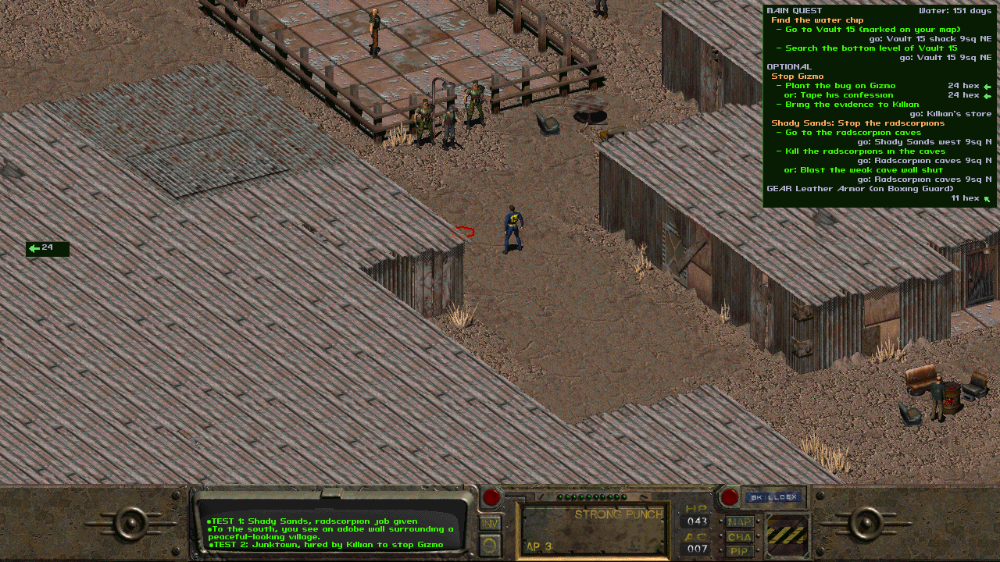
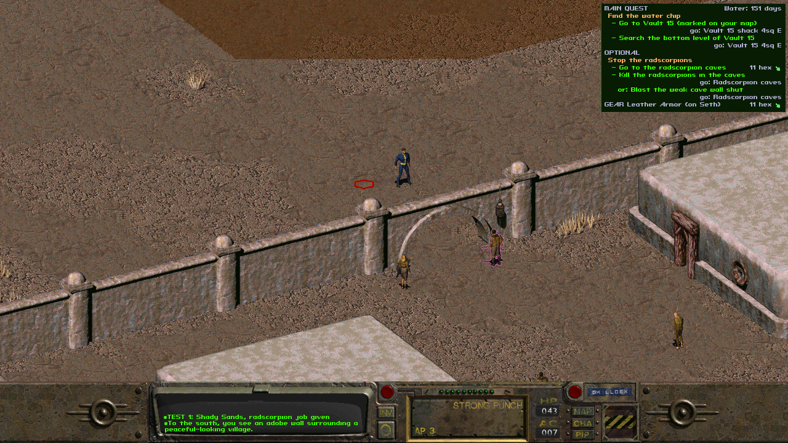
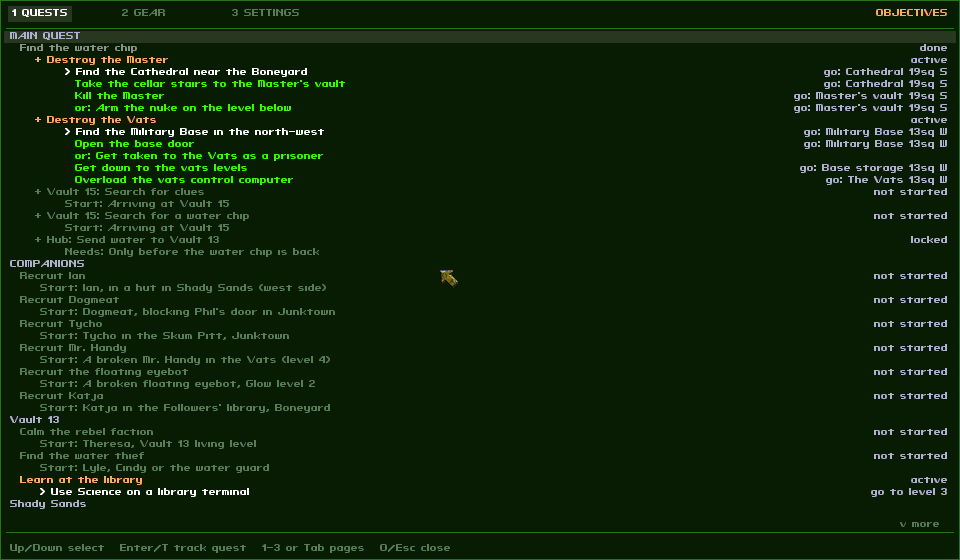
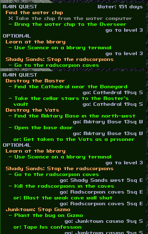
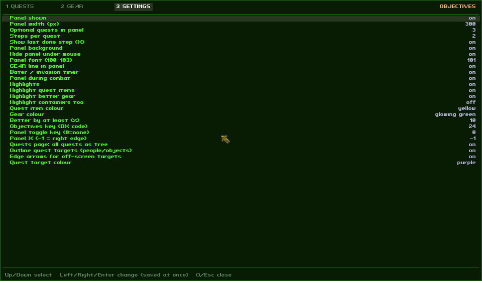

# Fallout 1in2 Objectives

A quest tracker for **Fallout 1in2** (Fallout 1 remade in the Fallout 2 engine, sfall 4.5),
installed as its own removable mod.



## What it does

- **Quest panel** on the right of the map screen (and on the world map): the main quest first,
  then optional quests, each with its exact next step, the distance in hexes and a direction
  arrow, or the place to travel to ("go: Junktown casino 9sq S"). Water chip countdown.
- **Alternative solutions**: steps that can be done in several ways show them as
  `or: ...` (talk him down / or: kill him, plant the bug / or: tape his confession...).
  Either one ticks the step off.
- **Markers on the map**: the people and objects your current steps point at get a purple
  outline; targets that are off screen get an arrow with the distance at the screen edge.
- **Item outlines** (no Motion Sensor needed): quest items yellow, weapons/armor better than
  what you use green. Works alongside the built-in Ctrl item highlighter.
- **Objectives window** (key `O`):
  1. *Quests*: every quest as a tree - main quest, companions, then each town. Shows which
     quests are locked and what unlocks them, who gives the ones you haven't started, and
     nests follow-up quests under the quest they come from (Destroy the Master / the Vats
     under the water chip, the Glow under becoming a Brotherhood initiate...).
  2. *Gear*: better weapons/armor on the current map, nearest first, and where they are.
  3. *Settings*: everything in `objectives.ini`, changeable in game.
- **Companions**: recruit quests for Ian, Dogmeat, Tycho, Katja, Mr. Handy and the eyebot.
- All 42 Pip-Boy quests plus jobs the Pip-Boy doesn't list (caravan guard jobs, Decker,
  Thieves' Circle, ...). Steps were checked against the Fo1in2 script sources; each step
  names the script line that sets it (`src` in the data files).
- Done steps stay done for that savegame (stored in the save), except repeatable jobs.

| | |
|---|---|
|  |  |
|  |  |

## Install

1. Get `fo1_objectives` (from a release zip, or build it, see below).
2. Copy the folder to `Fallout1in2/mods/fo1_objectives/`.
3. Add a line `fo1_objectives` to `Fallout1in2/mods/mods_order.txt`.

Uninstall: delete the folder and that line. Settings: `mods/fo1_objectives/objectives.ini`
or in game (O, then 3).

## Build

Needs Python 3, Wine and sfall's script compiler.

```bash
tools/fetch_vendor.sh          # Fo1in2 script sources -> vendor/ (headers, quest GVARs)
# put sfall's compile.exe (from the sfall modders pack) into tools/bin/
FO1IN2_DIR=/path/to/Fallout1in2 tools/build.sh    # data checks + compile -> dist/fo1_objectives
tools/install.sh               # copy into the game (keeps your in-game settings)
```

`FO1IN2_DIR` defaults to the Steam (Linux) location; the build reads quest tables, maps and
the palette from the installed `mods/fo1_base`.

## Layout

- `src/gl_objectives.ssl` - the sfall global script (panel, markers, outlines, window).
- `data/steps/*.txt` - quest steps per town; format in `data/steps/FORMAT.txt`.
- `tools/` - data compiler and checks (`build_data.py`, `objdata.py`, `test_data.py`),
  arrow images (`make_arrows.py`), build/install scripts.
- `mod/` - files shipped with the mod (ini, readme, arrow art).
- `test/gl_objtest.ssl` - test-only helper: Insert jumps through quest situations.
  Never ship it, never save with it installed.
- `DESIGN.md` - the original design.

## Credits

Fallout 1in2 by the Rotators team; sfall by the sfall team. Fallout is a trademark of
Bethesda Softworks. This mod contains no game assets.
